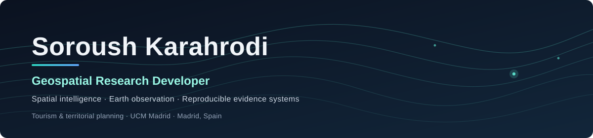
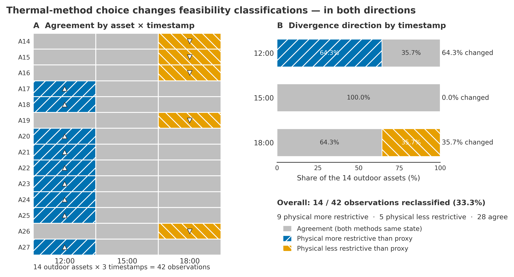

<a href="mailto:soroush.karahrodi79@gmail.com?subject=Contacto%20desde%20tu%20perfil%20de%20GitHub"><b>✉️ Email</b></a> &nbsp;·&nbsp;
<a href="https://www.linkedin.com/in/soroush-karahrodi-8672247a/"><b>💼 LinkedIn</b></a> &nbsp;·&nbsp;
<a href="https://www.researchgate.net/profile/Soroush-Karahrodi"><b>🔬 ResearchGate</b></a> &nbsp;·&nbsp;
<a href="https://github.com/soroushkarahrodi79-oss?tab=repositories"><b>📂 Todos los repositorios</b></a>

📍 Madrid, España &nbsp;·&nbsp; 🎓 Máster Universitario en Planificación y Gestión de Destinos Turísticos, Universidad Complutense de Madrid

🇬🇧 <a href="https://github.com/soroushkarahrodi79-oss/soroushkarahrodi79-oss#readme">Read in English</a>

Desarrollo software de investigación que convierte datos espaciales (registros urbanos oficiales, imágenes Sentinel-2, observaciones de campo) en evidencia con sus límites a la vista, para apoyar el análisis basado en evidencia de ciudades, espacios protegidos y destinos turísticos.

Mi formación es en turismo y planificación territorial. Los proyectos siguientes son de desarrollo independiente y están en fases distintas: software de investigación publicado, aplicaciones de investigación desplegadas, un MVP y prototipos de investigación experimentales. Cada uno indica su propio estado.

## 🧭 Por dónde empezar

| Si eres… | Empieza aquí | Qué encontrarás |
| --- | --- | --- |
| **Investigador/a o revisor/a** | [HATI-Madrid en Zenodo](https://doi.org/10.5281/zenodo.22707470) · [Estado y límites de las afirmaciones](https://github.com/soroushkarahrodi79-oss/heat-adaptive-tourism-madrid/blob/main/PROJECT_STATUS.md) | Un piloto archivado y citable, con lo que muestra y lo que no muestra explicado. |
| **Profesor/a o tutor/a** | [Madrid Lens: afirmaciones y limitaciones](https://github.com/soroushkarahrodi79-oss/madrid-tourism-intelligence-lens/blob/main/docs/CLAIMS_AND_LIMITATIONS.md) · [Informe de evidencia para la decisión de SNTO](https://github.com/soroushkarahrodi79-oss/snto-smart-tourism-observatory/blob/main/docs/PNSG_DECISION_EVIDENCE_BRIEF.md) | Cómo acoto las afirmaciones, documento la procedencia de los datos e informo cuando la evidencia es insuficiente. |
| **Estudiante** | [Lens en vivo](https://soroushkarahrodi79-oss.github.io/madrid-tourism-intelligence-lens/) · [Panel en vivo](https://snto-observatory.happyground-be027676.swedencentral.azurecontainerapps.io/) | Dos aplicaciones que puedes abrir y explorar sin instalar nada. |
| **Desarrollador/a** | [GeoImpact CI v1.2.0](https://github.com/soroushkarahrodi79-oss/geoimpact-ci/releases/tag/v1.2.0) · [Guía de reproducibilidad](https://github.com/soroushkarahrodi79-oss/heat-adaptive-tourism-madrid/blob/main/REPRODUCIBILITY.md) | Una herramienta de línea de comandos con dependencias fijadas y probada, y pipelines de investigación reproducibles. |
| **Quieres colaborar** | [Escríbeme](mailto:soroush.karahrodi79@gmail.com?subject=Contacto%20desde%20tu%20perfil%20de%20GitHub) | El email es lo mejor para consultas de investigación o colaboración; LinkedIn sirve para mensajes rápidos. |

## 📌 Evidencia destacada

**HATI-Madrid — Sensibilidad al método térmico.** En un piloto de un solo día en el centro de Madrid, el proxy operativo y la configuración físicamente basada SOLWEIG/UTCI asignaron clasificaciones de viabilidad distintas en 14 de 42 observaciones activo-momento (33,3 %). Esto demuestra sensibilidad a la elección del método, no superioridad ni precisión medida. Los resultados son derivados de modelo, no validados en campo, y el piloto no ha sido revisado por pares. [Registro en Zenodo (DOI)](https://doi.org/10.5281/zenodo.22707470) · [Estado y límites de las afirmaciones](https://github.com/soroushkarahrodi79-oss/heat-adaptive-tourism-madrid/blob/main/PROJECT_STATUS.md)

## 🗺️ Proyectos de un vistazo

| Proyecto | Pregunta que plantea | Fase | Abrir |
| --- | --- | --- | --- |
| **Madrid Urban Evidence Lens** | ¿Qué dicen las fuentes oficiales sobre un lugar de Madrid y qué no pueden mostrar? | 🟢 Software de investigación publicado, v0.1.0 | [En vivo](https://soroushkarahrodi79-oss.github.io/madrid-tourism-intelligence-lens/) · [Repo](https://github.com/soroushkarahrodi79-oss/madrid-tourism-intelligence-lens) |
| **GeoImpact CI** | ¿Qué relaciones espaciales cambia la edición de un polígono antes de fusionarla? | 🟢 Versión estable, v1.2.0 | [Release](https://github.com/soroushkarahrodi79-oss/geoimpact-ci/releases/tag/v1.2.0) · [Repo](https://github.com/soroushkarahrodi79-oss/geoimpact-ci) |
| **HATI-Madrid** | ¿Cambia la forma de representar el calor qué oportunidades turísticas superan el cribado? | 🔵 Piloto acotado, archivado (DOI) | [Zenodo](https://doi.org/10.5281/zenodo.22707470) · [Repo](https://github.com/soroushkarahrodi79-oss/heat-adaptive-tourism-madrid) |
| **SNTO** | ¿Dónde debería mirar primero la inspección de campo en un espacio protegido? | 🟠 Prototipo de investigación, v2.0.0, desplegado | [En vivo](https://snto-observatory.happyground-be027676.swedencentral.azurecontainerapps.io/) · [Repo](https://github.com/soroushkarahrodi79-oss/snto-smart-tourism-observatory) |
| **FieldOS** | ¿Cómo registrar observaciones de campo sin conexión y con procedencia? | 🟡 MVP, una sesión de campo | [App](https://fieldos-sigma.vercel.app/) · [Repo](https://github.com/soroushkarahrodi79-oss/fieldos) |

## 🔍 Investigación y software seleccionados

### [Madrid Urban Evidence Lens](https://github.com/soroushkarahrodi79-oss/madrid-tourism-intelligence-lens)

*¿Qué dicen las fuentes oficiales sobre un lugar de Madrid y qué no pueden mostrar?*

Un espacio de trabajo cartográfico en el navegador para comparar dos lugares, o dos ámbitos de planeamiento oficiales, en turismo, movilidad, contexto de calor acotado, fases de desarrollo y edificabilidad del planeamiento y licencias urbanísticas concedidas. Un panel de evidencia muestra la fuente, la fecha y el límite de cada valor, un menú fijo de preguntas basadas en registros puede abstenerse de responder, y las lecturas se pueden compartir por URL y exportar con su geometría.

**Estado:** software de investigación publicado con pruebas automáticas; última versión etiquetada v0.1.0, con `main` por delante. No es un análisis de planeamiento estatutario ni cubre todo el PGOUM, y no hace recomendaciones.

[Lens en vivo](https://soroushkarahrodi79-oss.github.io/madrid-tourism-intelligence-lens/) · [Afirmaciones y limitaciones](https://github.com/soroushkarahrodi79-oss/madrid-tourism-intelligence-lens/blob/main/docs/CLAIMS_AND_LIMITATIONS.md) · [Procedencia de los datos](https://github.com/soroushkarahrodi79-oss/madrid-tourism-intelligence-lens/blob/main/docs/DATA_PROVENANCE.md)

### [GeoImpact CI](https://github.com/soroushkarahrodi79-oss/geoimpact-ci)

*¿Qué relaciones espaciales cambia la edición de un polígono antes de fusionarla?*

Una herramienta determinista de línea de comandos en Python para pruebas de regresión de cambios de geometría. Compara polígonos GeoJSON BASE y CANDIDATE, comprueba relaciones declaradas de punto en polígono y escribe evidencia canónica en JSON, Markdown y GeoJSON con un código de salida PASS o BLOCK para CI. Las dependencias están fijadas, las entradas llevan identidades SHA-256 y las instalaciones están cualificadas en Linux y Windows. Dos casos con datos reales se reproducen desde scripts versionados: instantáneas de secciones censales de Madrid y un control negativo en un espacio protegido.

**Estado:** versión estable v1.2.0 con un contrato deliberadamente estrecho; sin DOI.

[Release v1.2.0](https://github.com/soroushkarahrodi79-oss/geoimpact-ci/releases/tag/v1.2.0) · [Caso Madrid](https://github.com/soroushkarahrodi79-oss/geoimpact-ci/blob/main/docs/GATE_5_REAL_WORLD_CASE.md) · [Archivo de citación](https://github.com/soroushkarahrodi79-oss/geoimpact-ci/blob/main/CITATION.cff)

### [HATI-Madrid](https://github.com/soroushkarahrodi79-oss/heat-adaptive-tourism-madrid)

*¿Cambia la forma de representar el calor qué oportunidades turísticas superan el cribado?*

Un piloto de investigación que compara un proxy operativo simple con una configuración físicamente basada SOLWEIG/UTCI dentro de un mismo diseño de cribado que parte de las restricciones: ocho escenarios preregistrados, sin puntuación compuesta y con un resultado explícito de «ninguno sobrevive».

**Estado:** un piloto acotado y no revisado por pares, de un solo día (21 de agosto de 2023) y unos 3,5 km² del centro de Madrid, con resultados térmicos derivados de modelo y sin validación en campo. Una extensión posterior terminó en «sin diferencia robusta» y está congelada.

[Registro en Zenodo (DOI)](https://doi.org/10.5281/zenodo.22707470) · [Preprint en ResearchGate](https://www.researchgate.net/publication/414226835_Thermal_representation_as_a_decision_variable_in_heat-adaptive_tourism_opportunity_screening_evidence_from_a_Madrid_pilot) · [Estado y límites de las afirmaciones](https://github.com/soroushkarahrodi79-oss/heat-adaptive-tourism-madrid/blob/main/PROJECT_STATUS.md) · [Reproducibilidad](https://github.com/soroushkarahrodi79-oss/heat-adaptive-tourism-madrid/blob/main/REPRODUCIBILITY.md)

### [SNTO: Smart Nature Tourism Observatory](https://github.com/soroushkarahrodi79-oss/snto-smart-tourism-observatory)

*¿Dónde debería mirar primero la inspección de campo en un espacio protegido?*

Un pipeline Sentinel-2 y un panel para el Parque Nacional de la Sierra de Guadarrama. Deriva indicadores de condición de la vegetación y de cambio (EHS/NDVI) a partir de observaciones de 2021–2026 a nivel de huella de senda y de activo, junto con datos espaciales oficiales.

**Estado:** prototipo de investigación, v2.0.0, desplegado en Azure. Su techo es el seguimiento y la inspección de campo: no hay datos de presión de visitantes, no establece causalidad turística y la validación de campo está pendiente. El propio informe de decisión del proyecto concluye que la evidencia actual es mayormente insuficiente para priorizar, y los módulos de escenarios usan datos sintéticos etiquetados. Licenciado para uso académico (código disponible; no es de código abierto).

[Panel en vivo](https://snto-observatory.happyground-be027676.swedencentral.azurecontainerapps.io/) · [Registro en Zenodo (DOI)](https://doi.org/10.5281/zenodo.20818269) · [Informe de evidencia para la decisión](https://github.com/soroushkarahrodi79-oss/snto-smart-tourism-observatory/blob/main/docs/PNSG_DECISION_EVIDENCE_BRIEF.md)

### Instrumento complementario: [FieldOS](https://github.com/soroushkarahrodi79-oss/fieldos)

Una app de observación de campo que funciona primero sin conexión, con sesiones ligadas a un protocolo, procedencia GPS, fotos y notas de voz, y exportación a JSON, CSV, GeoJSON y ZIP. Es un MVP: una sesión de campo atestiguada por el propietario en un único iPhone; Android sin probar. [App](https://fieldos-sigma.vercel.app/) · [Registro de la sesión de campo](https://github.com/soroushkarahrodi79-oss/fieldos/blob/main/docs/FIRST_FIELD_RUN.md)

## 🧪 Principios de investigación

> **Lugar → Evidencia → Interpretación → Decisión**

Distingo tres tipos de evidencia: **observada** (registrada por un instrumento, un registro o una persona), **derivada** (calculada a partir de observaciones mediante una transformación documentada) y **modelada** (resultado de un modelo cuyos supuestos importan, nunca presentada como una medición). En mis proyectos documento la incertidumbre y los límites de las afirmaciones junto a los resultados, y cuando la evidencia es insuficiente considero que abstenerse es la salida correcta.

## 📚 Transparencia y reproducibilidad de la investigación

| Proyecto | Licencia del código | Citación y archivo |
| --- | --- | --- |
| Madrid Lens | MIT | Todavía no |
| GeoImpact CI | MIT | CITATION.cff; sin DOI |
| HATI-Madrid | Ninguna publicada | CITATION.cff; DOI de Zenodo |
| SNTO | Uso académico, no es código abierto | CITATION.cff; DOI de Zenodo |
| FieldOS | Apache-2.0 | Todavía no |

CITATION.cff aporta los metadatos para citar; un DOI de Zenodo identifica un registro de investigación archivado. Las condiciones del preprint de HATI se fijan en su registro de Zenodo y son independientes del código, que no tiene archivo de licencia. Madrid Lens, GeoImpact CI, SNTO y FieldOS ejecutan CI en GitHub Actions; HATI no. La CI verifica el comportamiento de ingeniería, no la validez científica, y ni un DOI ni un archivo de citación implican corrección.

## 🤝 Contribuciones de código abierto

- [geemap #2887](https://github.com/gee-community/geemap/pull/2887): **fusionada**. Añade cobertura de pruebas para `rgb_to_hex`.
- [pystac-client #934](https://github.com/stac-utils/pystac-client/pull/934): **abierta, no fusionada**. Añade `set_parameter` a `BaseSearch`, disponible mediante `ItemSearch` y `CollectionSearch`, como vía pública para fijar parámetros de petición que el constructor no cubre.

## 🛠️ Enfoque técnico

| Área | Herramientas |
| --- | --- |
| **Análisis geoespacial y observación de la Tierra** | Python, Shapely, PyProj, GeoPandas, Rasterio, STAC, Google Earth Engine, SOLWEIG |
| **Software de investigación e ingeniería de datos** | Paquetes y CLIs en Python, PostgreSQL/PostGIS, FastAPI, Docker, Azure Container Apps |
| **Interfaces geoespaciales interactivas** | Leaflet, MapLibre GL, React y TypeScript, Streamlit |
| **Pruebas y reproducibilidad** | pytest, Playwright, Vitest, GitHub Actions, CITATION.cff, Zenodo |

## 📬 Contacto y colaboración

Me interesan las conversaciones sobre colaboración en investigación, software de investigación geoespacial, calidad de datos espaciales, observación de la Tierra y análisis urbano y turístico basado en evidencia. La revisión crítica de mis métodos y de los límites de mis afirmaciones es especialmente útil.

| Canal | Ideal para | Enlace |
| --- | --- | --- |
| ✉️ **Email** | Colaboración en investigación, preguntas sobre un proyecto, solicitudes de tutoría o revisión | [soroush.karahrodi79@gmail.com](mailto:soroush.karahrodi79@gmail.com?subject=Contacto%20desde%20tu%20perfil%20de%20GitHub) |
| 💼 **LinkedIn** | Colaboración, consultas profesionales, mensajes rápidos | [soroush-karahrodi](https://www.linkedin.com/in/soroush-karahrodi-8672247a/) |
| 🔬 **ResearchGate** | Preguntas de investigación, el preprint de HATI-Madrid | [Soroush-Karahrodi](https://www.researchgate.net/profile/Soroush-Karahrodi) |
| 📂 **GitHub** | Código, incidencias sobre un repositorio concreto | [soroushkarahrodi79-oss](https://github.com/soroushkarahrodi79-oss) |

## 🗄️ Archivo de investigación

- [Iran Soil Landscapes](https://github.com/soroushkarahrodi79-oss/iran-soil-landscape): cartografía reproducible del grupo de suelo dominante de Irán a partir de HWSD v2.01, con procedencia verificada por sumas de comprobación; el relieve es solo contexto visual y no es un inventario de suelos validado en campo.
- [CHALUS](https://github.com/soroushkarahrodi79-oss/CHALUS): un piloto histórico de accesibilidad viaria para el oeste de Mazandarán, **cerrado como NO-GO** porque no se cumplió el estándar de verificación preregistrado. Se detuvo antes de cualquier análisis de observación de la Tierra y no hace afirmaciones sobre demora ni demanda turística.

Otros prototipos y experimentos

- [Tourism Intelligence Desk](https://github.com/soroushkarahrodi79-oss/tourism-intelligence-desk): prototipo de integración que presenta evidencia acotada de HATI y SNTO.
- [Spatial Intelligence Atlas](https://github.com/soroushkarahrodi79-oss/spatial-intelligence-atlas): mapa explicativo estático de casos de investigación seleccionados, no una plataforma integrada.
- [FIRSTLOOK-MAD](https://github.com/soroushkarahrodi79-oss/firstlook-mad): prototipo de investigación de respuesta a incendios con UAS, solo en simulación.
- [FAB (Field Atlas)](https://github.com/soroushkarahrodi79-oss/fab): evidencia mezclada auténtica, derivada y simulada; su conexión con Sentinel-2 real no está cableada.
- [Tourism Signal Radar](https://github.com/soroushkarahrodi79-oss/radar): registro de validación; no se ha autorizado ninguna compilación independiente.
- [SNTO Alpine](https://github.com/soroushkarahrodi79-oss/snto-alpine): prototipo derivado de Sierra Nevada; no hereda la validación ni el DOI de SNTO.
- [Kelar](https://github.com/soroushkarahrodi79-oss/Kelar): registros de inicio y de un piloto de recuperación acotado; análisis de casos no autorizado.
- [JOB](https://github.com/soroushkarahrodi79-oss/JOB): prototipo de mercado de trabajo flexible con datos sintéticos.

