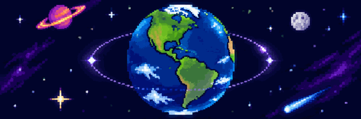

# Soroush Karahrodi

**Geospatial Researcher & GIS Analyst** · Earth Observation · Spatial Intelligence

Madrid, Spain · MSc in Tourism Destination Planning & Management, Universidad Complutense de Madrid (in progress)

[Español — detailed research profile](README.es.md)

I build **reproducible geospatial research software** that turns official records, satellite observations and field data into traceable evidence. My interests span urban analysis, protected areas, climate adaptation and spatial AI. I make the **sources, uncertainty and limits** visible rather than treating model outputs as facts.

## Selected projects

| Project | Focus | Explore |
| --- | --- | --- |
| **Madrid Urban Evidence Lens** | Interactive mapping of official Madrid data, with provenance and limits on interpretation. | [Live map](https://soroushkarahrodi79-oss.github.io/madrid-tourism-intelligence-lens/) · [Code](https://github.com/soroushkarahrodi79-oss/madrid-tourism-intelligence-lens) |
| **SK Spatial Intelligence Lab** | Read-only Madrid Evidence MCP, local investigation interface and reproducible, exploratory agent evaluations. | [Public showcase](https://huggingface.co/spaces/soroushkararodi/sk-spatial-intelligence-lab) · [Code](https://github.com/soroushkarahrodi79-oss/sk-spatial-intelligence-lab) |
| **HATI-Madrid** | Bounded heat-adaptive tourism research pilot comparing operational and model-based thermal screening. | [Zenodo DOI](https://doi.org/10.5281/zenodo.22707470) · [Code](https://github.com/soroushkarahrodi79-oss/heat-adaptive-tourism-madrid) |
| **SNTO** | Sentinel-2-based nature-tourism monitoring prototype for Sierra de Guadarrama. | [Research record](https://doi.org/10.5281/zenodo.20818269) · [Code](https://github.com/soroushkarahrodi79-oss/snto-smart-tourism-observatory) |
| **GeoImpact CI** | Released deterministic spatial regression checks for geometry changes (v1.2.0). | [Release](https://github.com/soroushkarahrodi79-oss/geoimpact-ci/releases/tag/v1.2.0) · [Code](https://github.com/soroushkarahrodi79-oss/geoimpact-ci) |

**Recent SK LAB result:** [Madrid Evidence MCP Stage 2](https://github.com/soroushkarahrodi79-oss/sk-spatial-intelligence-lab/blob/main/mcp/madrid-evidence/eval/results-stage2/informe-stage2.es.md) is a merged, reproducible **single-arm exploratory** evaluation: 12 adversarial runs, 0 observed critical errors and 1 unsupported local claim; **MODIFY (provisional)**. The blind reader was a language model, not an independent human adjudicator. These results do not establish MCP safety or comparative improvement.

Additional prototypes: **[FieldOS](https://github.com/soroushkarahrodi79-oss/fieldos)** (offline-first field observations) and **[Madrid Isovist Demo](https://github.com/soroushkarahrodi79-oss/madrid-isovist-demo)** (browser-based 2D geometric visibility, not field-validated).

## Skills & Toolbox

**GIS & Remote Sensing** 

**Programming & Data** 

**Geospatial Libraries** 

**Development Tools** 

## Research approach

**Place → Evidence → Interpretation → Decision.** I distinguish observed, derived and modelled results, document methodological limits, and treat insufficient evidence as a valid outcome. These projects have different maturity levels; an archive or working application is not, by itself, scientific validation.

**Interested in collaboration?** [Get in touch](mailto:soroush.karahrodi79@gmail.com) about geospatial research, Earth observation or evidence-based territorial analysis.
