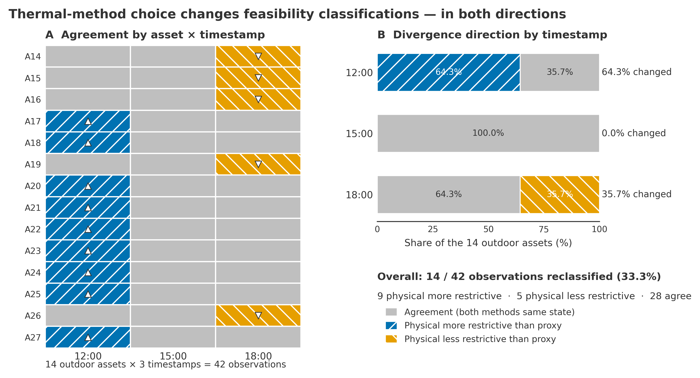

<a href="https://www.linkedin.com/in/soroush-karahrodi-8672247a/"><b>💼 LinkedIn</b></a> &nbsp;·&nbsp;
<a href="https://www.researchgate.net/profile/Soroush-Karahrodi"><b>🔬 ResearchGate</b></a> &nbsp;·&nbsp;
<a href="https://github.com/soroushkarahrodi79-oss?tab=repositories"><b>📂 All repositories</b></a>

📍 Madrid, Spain &nbsp;·&nbsp; 🎓 Máster en Planificación y Gestión de Destinos Turísticos, Universidad Complutense de Madrid

I build research software that turns spatial data (official urban records, Sentinel-2 imagery, field observations) into evidence with its limits attached, to support evidence-based analysis of cities, protected areas and tourist destinations.

My background is tourism and territorial planning. The projects below are independently developed and at different stages: released research software, deployed research applications, an MVP, and experimental research prototypes. Each states its own status.

## 🧭 Where to start

| If you are… | Start here | What you will find |
| --- | --- | --- |
| **A researcher or reviewer** | [HATI-Madrid on Zenodo](https://doi.org/10.5281/zenodo.22707470) · [Status and claim limits](https://github.com/soroushkarahrodi79-oss/heat-adaptive-tourism-madrid/blob/main/PROJECT_STATUS.md) | An archived, citable pilot, with what it does and does not show spelled out. |
| **A professor or supervisor** | [Madrid Lens: claims and limitations](https://github.com/soroushkarahrodi79-oss/madrid-tourism-intelligence-lens/blob/main/docs/CLAIMS_AND_LIMITATIONS.md) · [SNTO decision-evidence brief](https://github.com/soroushkarahrodi79-oss/snto-smart-tourism-observatory/blob/main/docs/PNSG_DECISION_EVIDENCE_BRIEF.md) | How I scope claims, document data provenance and report insufficient evidence. |
| **A student** | [Live lens](https://soroushkarahrodi79-oss.github.io/madrid-tourism-intelligence-lens/) · [Live dashboard](https://snto-observatory.happyground-be027676.swedencentral.azurecontainerapps.io/) | Two applications you can open and explore without installing anything. |
| **A developer** | [GeoImpact CI v1.2.0](https://github.com/soroushkarahrodi79-oss/geoimpact-ci/releases/tag/v1.2.0) · [Reproducibility guide](https://github.com/soroushkarahrodi79-oss/heat-adaptive-tourism-madrid/blob/main/REPRODUCIBILITY.md) | A pinned, tested command-line tool and reproducible research pipelines. |
| **Looking to collaborate** | [Contact](https://www.linkedin.com/in/soroush-karahrodi-8672247a/) | LinkedIn and ResearchGate are the fastest ways to reach me. |

## 📌 Featured evidence

**HATI-Madrid — Thermal-method sensitivity.** In a single-day central Madrid pilot, the operational proxy and physically based SOLWEIG/UTCI configuration assigned different feasibility classifications to 14 of 42 asset-time observations (33.3%). This demonstrates sensitivity to method choice, not superiority or measured accuracy. Results are model-derived, not field-validated, and the pilot is not peer-reviewed. [Zenodo record (DOI)](https://doi.org/10.5281/zenodo.22707470) · [Status and claim limits](https://github.com/soroushkarahrodi79-oss/heat-adaptive-tourism-madrid/blob/main/PROJECT_STATUS.md)

## 🗺️ Projects at a glance

| Project | Question it asks | Stage | Open |
| --- | --- | --- | --- |
| **Madrid Urban Evidence Lens** | What do official sources say about a place in Madrid, and what can't they show? | 🟢 Published research software, v0.1.0 | [Live](https://soroushkarahrodi79-oss.github.io/madrid-tourism-intelligence-lens/) · [Repo](https://github.com/soroushkarahrodi79-oss/madrid-tourism-intelligence-lens) |
| **GeoImpact CI** | Which spatial relationships does a polygon edit change before you merge it? | 🟢 Stable release, v1.2.0 | [Release](https://github.com/soroushkarahrodi79-oss/geoimpact-ci/releases/tag/v1.2.0) · [Repo](https://github.com/soroushkarahrodi79-oss/geoimpact-ci) |
| **HATI-Madrid** | Does the way heat is represented change which tourism opportunities survive screening? | 🔵 Bounded pilot, archived (DOI) | [Zenodo](https://doi.org/10.5281/zenodo.22707470) · [Repo](https://github.com/soroushkarahrodi79-oss/heat-adaptive-tourism-madrid) |
| **SNTO** | Where should field inspection look first in a protected area? | 🟠 Research prototype, v2.0.0, deployed | [Live](https://snto-observatory.happyground-be027676.swedencentral.azurecontainerapps.io/) · [Repo](https://github.com/soroushkarahrodi79-oss/snto-smart-tourism-observatory) |
| **FieldOS** | How do you record field observations offline with provenance? | 🟡 MVP, one field session | [App](https://fieldos-sigma.vercel.app/) · [Repo](https://github.com/soroushkarahrodi79-oss/fieldos) |

## 🔍 Selected research and software

### [Madrid Urban Evidence Lens](https://github.com/soroushkarahrodi79-oss/madrid-tourism-intelligence-lens)

*What do official sources say about a place in Madrid, and what can't they show?*

A browser map workspace for comparing two places, or two official planning ámbitos, across tourism, mobility, bounded heat context, planning development phases and buildability, and granted urban licences. An evidence drawer shows each value's source, date and limit, a fixed menu of registry-backed questions can abstain, and readings can be shared by URL and exported with geometry.

**Status:** published research software with automated tests; latest tagged release v0.1.0, with `main` ahead. It is not a statutory planning analysis or full PGOUM coverage, and it makes no recommendations.

[Live lens](https://soroushkarahrodi79-oss.github.io/madrid-tourism-intelligence-lens/) · [Claims and limitations](https://github.com/soroushkarahrodi79-oss/madrid-tourism-intelligence-lens/blob/main/docs/CLAIMS_AND_LIMITATIONS.md) · [Data provenance](https://github.com/soroushkarahrodi79-oss/madrid-tourism-intelligence-lens/blob/main/docs/DATA_PROVENANCE.md)

### [GeoImpact CI](https://github.com/soroushkarahrodi79-oss/geoimpact-ci)

*Which spatial relationships does a polygon edit change before you merge it?*

A deterministic Python command-line tool for geometry-change regression testing. It compares BASE and CANDIDATE GeoJSON polygons, checks declared point-in-polygon relationships, and writes canonical JSON, Markdown and GeoJSON evidence with a PASS or BLOCK exit code for CI. Dependencies are pinned, inputs carry SHA-256 identities, and installs are qualified on Linux and Windows. Two real-data cases reproduce from committed scripts: Madrid census-section snapshots and a protected-area negative control.

**Status:** stable v1.2.0 with a deliberately narrow contract; no DOI.

[v1.2.0 release](https://github.com/soroushkarahrodi79-oss/geoimpact-ci/releases/tag/v1.2.0) · [Madrid case](https://github.com/soroushkarahrodi79-oss/geoimpact-ci/blob/main/docs/GATE_5_REAL_WORLD_CASE.md) · [Citation file](https://github.com/soroushkarahrodi79-oss/geoimpact-ci/blob/main/CITATION.cff)

### [HATI-Madrid](https://github.com/soroushkarahrodi79-oss/heat-adaptive-tourism-madrid)

*Does the way heat is represented change which tourism opportunities survive screening?*

A research pilot comparing a simple operational proxy with a physically based SOLWEIG/UTCI configuration inside one constraint-first screening design: eight pre-registered scenarios, no composite score, and an explicit no-survivor outcome.

**Status:** a bounded, non-peer-reviewed pilot covering one day (21 August 2023) and about 3.5 km² of central Madrid, with model-derived thermal outputs and no field validation. A later extension ended in "no robust difference" and is frozen.

[Zenodo record (DOI)](https://doi.org/10.5281/zenodo.22707470) · [ResearchGate preprint](https://www.researchgate.net/publication/414226835_Thermal_representation_as_a_decision_variable_in_heat-adaptive_tourism_opportunity_screening_evidence_from_a_Madrid_pilot) · [Status and claim limits](https://github.com/soroushkarahrodi79-oss/heat-adaptive-tourism-madrid/blob/main/PROJECT_STATUS.md) · [Reproducibility](https://github.com/soroushkarahrodi79-oss/heat-adaptive-tourism-madrid/blob/main/REPRODUCIBILITY.md)

### [SNTO: Smart Nature Tourism Observatory](https://github.com/soroushkarahrodi79-oss/snto-smart-tourism-observatory)

*Where should field inspection look first in a protected area?*

A Sentinel-2 pipeline and dashboard for Sierra de Guadarrama National Park. It derives vegetation-condition and change indicators (EHS/NDVI) from 2021–2026 observations at trail and asset footprint level, alongside official spatial data.

**Status:** research prototype, v2.0.0, deployed on Azure. Its ceiling is monitoring and field inspection: no visitor-pressure data, no tourism causation, field validation pending. The project's own decision brief finds current evidence mostly insufficient to prioritise, and scenario modules use labelled synthetic data. Licensed for academic use (source-available; not open source).

[Live dashboard](https://snto-observatory.happyground-be027676.swedencentral.azurecontainerapps.io/) · [Zenodo record (DOI)](https://doi.org/10.5281/zenodo.20818269) · [Decision-evidence brief](https://github.com/soroushkarahrodi79-oss/snto-smart-tourism-observatory/blob/main/docs/PNSG_DECISION_EVIDENCE_BRIEF.md)

### Complementary instrument: [FieldOS](https://github.com/soroushkarahrodi79-oss/fieldos)

An offline-first field-observation app with protocol-bound sessions, GPS provenance, photos and voice notes, and JSON, CSV, GeoJSON and ZIP export. It is an MVP: one owner-attested field session on a single iPhone, Android untested. [App](https://fieldos-sigma.vercel.app/) · [Field-run record](https://github.com/soroushkarahrodi79-oss/fieldos/blob/main/docs/FIRST_FIELD_RUN.md)

## 🧪 Research principles

> **Place → Evidence → Interpretation → Decision**

Evidence comes in three kinds that I keep apart: **observed** (recorded by an instrument, register or person), **derived** (computed from observations by a documented transformation) and **modelled** (the output of a model whose assumptions matter, never presented as a measurement). In my projects I document uncertainty and claim limits alongside results, and where the evidence is insufficient I treat abstaining as the correct output.

## 📚 Research transparency and reproducibility

| Project | Code licence | Citation and archive |
| --- | --- | --- |
| Madrid Lens | MIT | None yet |
| GeoImpact CI | MIT | CITATION.cff; no DOI |
| HATI-Madrid | None published | CITATION.cff; Zenodo DOI |
| SNTO | Academic use, not open source | CITATION.cff; Zenodo DOI |
| FieldOS | Apache-2.0 | None yet |

CITATION.cff supplies citation metadata; a Zenodo DOI identifies an archived research record. HATI's preprint terms are set on its Zenodo record and are separate from the code, which has no licence file. Madrid Lens, GeoImpact CI, SNTO and FieldOS run CI on GitHub Actions; HATI does not. CI verifies engineering behaviour, not scientific validity, and neither a DOI nor a citation file implies correctness.

## 🤝 Open-source contributions

- [geemap #2887](https://github.com/gee-community/geemap/pull/2887): **merged**. Adds test coverage for `rgb_to_hex`.
- [pystac-client #934](https://github.com/stac-utils/pystac-client/pull/934): **open, not merged**. Adds `set_parameter` to `BaseSearch`, available through `ItemSearch` and `CollectionSearch`, as a public way to set request parameters the constructor does not cover.

## 🛠️ Technical focus

| Area | Tools |
| --- | --- |
| **Geospatial analysis and Earth observation** | Python, Shapely, PyProj, GeoPandas, Rasterio, STAC, Google Earth Engine, SOLWEIG |
| **Research software and data engineering** | Python packaging and CLIs, PostgreSQL/PostGIS, FastAPI, Docker, Azure Container Apps |
| **Interactive geospatial interfaces** | Leaflet, MapLibre GL, React and TypeScript, Streamlit |
| **Testing and reproducibility** | pytest, Playwright, Vitest, GitHub Actions, CITATION.cff, Zenodo |

## 📬 Contact and collaboration

I welcome conversations about research collaboration, geospatial research software, spatial data quality, Earth observation, and evidence-based urban and tourism analysis. Critical review of my methods and claim limits is especially useful.

| Channel | Best for | Link |
| --- | --- | --- |
| 💼 **LinkedIn** | Collaboration, professional enquiries, quick messages | [soroush-karahrodi](https://www.linkedin.com/in/soroush-karahrodi-8672247a/) |
| 🔬 **ResearchGate** | Research questions, the HATI-Madrid preprint | [Soroush-Karahrodi](https://www.researchgate.net/profile/Soroush-Karahrodi) |
| 📂 **GitHub** | Code, issues on a specific repository | [soroushkarahrodi79-oss](https://github.com/soroushkarahrodi79-oss) |

## 🗄️ Research archive

- [Iran Soil Landscapes](https://github.com/soroushkarahrodi79-oss/iran-soil-landscape): reproducible dominant soil-group mapping of Iran from HWSD v2.01 with checksummed provenance; terrain is visual context only, and it is not a field-validated soil survey.
- [CHALUS](https://github.com/soroushkarahrodi79-oss/CHALUS): a historical road-accessibility pilot for western Mazandaran, **closed as NO-GO** because the pre-registered verification standard was not met. It stopped before any Earth-observation analysis and makes no claims about tourist delay or demand.

Other prototypes and experiments

- [Tourism Intelligence Desk](https://github.com/soroushkarahrodi79-oss/tourism-intelligence-desk): integration prototype presenting bounded HATI and SNTO evidence.
- [Spatial Intelligence Atlas](https://github.com/soroushkarahrodi79-oss/spatial-intelligence-atlas): static explanatory map of selected research cases, not an integrated platform.
- [FIRSTLOOK-MAD](https://github.com/soroushkarahrodi79-oss/firstlook-mad): simulation-only UAS wildfire-response research prototype.
- [FAB (Field Atlas)](https://github.com/soroushkarahrodi79-oss/fab): mixed authentic, derived and simulated evidence; its real Sentinel-2 seam is not wired.
- [Tourism Signal Radar](https://github.com/soroushkarahrodi79-oss/radar): validation record; no standalone build authorised.
- [SNTO Alpine](https://github.com/soroushkarahrodi79-oss/snto-alpine): derived Sierra Nevada prototype; it does not inherit SNTO's validation or DOI.
- [Kelar](https://github.com/soroushkarahrodi79-oss/Kelar): inception and bounded retrieval-pilot records; case analysis not authorised.
- [JOB](https://github.com/soroushkarahrodi79-oss/JOB): flexible-work marketplace prototype with synthetic data.

