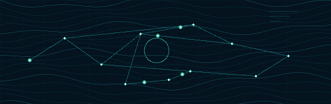

# Soroush Karahrodi

**Geospatial Research Developer** · GIS · Earth Observation · Spatial Intelligence

Madrid, Spain · MSc in Tourism Destination Planning & Management, Universidad Complutense de Madrid (in progress)

[LinkedIn](https://www.linkedin.com/in/soroush-karahrodi-8672247a/) · [ORCID](https://orcid.org/0009-0003-8495-4601) · [ResearchGate](https://www.researchgate.net/profile/Soroush-Karahrodi) · [Hugging Face Lab](https://huggingface.co/spaces/soroushkararodi/sk-spatial-intelligence-lab) · [Email](mailto:soroush.karahrodi79@gmail.com)

[Español — detailed research profile](README.es.md)

I build **reproducible geospatial research software** that turns official records, satellite observations and field data into traceable evidence. My interests span urban analysis, protected areas, climate adaptation and spatial AI. I make the **sources, uncertainty and limits** visible rather than treating model outputs as facts.

## Selected projects

| Project | Focus | Explore |
| --- | --- | --- |
| **Madrid Urban Evidence Lens** | Interactive mapping of official Madrid data, with provenance and limits on interpretation. | [Live map](https://soroushkarahrodi79-oss.github.io/madrid-tourism-intelligence-lens/) · [Code](https://github.com/soroushkarahrodi79-oss/madrid-tourism-intelligence-lens) |
| **SK Spatial Intelligence Lab** | Evidence-first geospatial tools, a read-only Madrid Evidence MCP prototype and exploratory evaluations. | [Public Lab](https://huggingface.co/spaces/soroushkararodi/sk-spatial-intelligence-lab) · [Code](https://github.com/soroushkarahrodi79-oss/sk-spatial-intelligence-lab) |
| **HATI-Madrid** | Bounded heat-adaptive tourism research pilot comparing operational and model-based thermal screening. | [Zenodo DOI](https://doi.org/10.5281/zenodo.22707470) · [Code](https://github.com/soroushkarahrodi79-oss/heat-adaptive-tourism-madrid) |
| **SNTO** | Sentinel-2-based nature-tourism monitoring prototype for Sierra de Guadarrama. | [Research record](https://doi.org/10.5281/zenodo.20818269) · [Code](https://github.com/soroushkarahrodi79-oss/snto-smart-tourism-observatory) |

Also exploring **[GeoImpact CI](https://github.com/soroushkarahrodi79-oss/geoimpact-ci)** (spatial regression testing) and **[FieldOS](https://github.com/soroushkarahrodi79-oss/fieldos)** (structured field observations).

## Toolkit

`Python` · `GeoPandas` · `Rasterio` · `QGIS` · `PostGIS` · `Google Earth Engine` · `Leaflet / MapLibre` · `React / TypeScript` · `GitHub Actions`

## Research approach

**Place → Evidence → Interpretation → Decision.** I distinguish observed, derived and modelled results, document methodological limits, and treat insufficient evidence as a valid outcome. These projects have different maturity levels; an archive or working application is not, by itself, scientific validation.

**Interested in collaboration?** [Get in touch](mailto:soroush.karahrodi79@gmail.com) about geospatial research, Earth observation or evidence-based territorial analysis.
